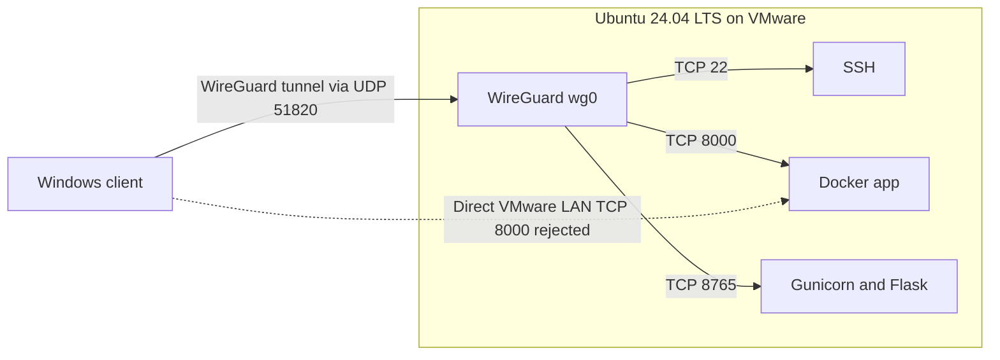

# WireGuard VPN Monitoring & Secure Docker Access

A local DevOps lab that connects Windows to an Ubuntu VM over WireGuard, restricts direct VMware LAN access to a Docker application, and shows real VPN statistics in a browser dashboard.

**What the lab demonstrated:** SSH worked through the VPN, the Docker app returned `HTTP 200 OK` through the VPN, and a direct IPv4 TCP connection to the same published port over the VMware LAN was rejected.


## Architecture



| Component | Role in the lab |
| --- | --- |
| Windows WireGuard client | Uses `10.66.77.2/32` and routes the server VPN address through the tunnel. |
| Ubuntu VPN server | Uses `10.66.77.1/24` on `wg0`. The VMware endpoint is `192.168.132.165:51820/UDP`. |
| Docker and iptables | Runs `devops-app` on published TCP port `8000`. A `DOCKER-USER` rule matches traffic from `ens33` toward `docker0` using the original destination port rather than the container IP. |
| Flask and Gunicorn | Serves the dashboard on `10.66.77.1:8765`. Gunicorn runs as a non-root user under systemd. |
| systemd timer and Python collector | Samples WireGuard every 30 seconds and writes a JSON snapshot. The dashboard reads it through `/api/status` every 10 seconds. |

## How monitoring works

The collector writes a read-only summary for the web app containing the tunnel status, peer count, handshake age, and cumulative received and sent bytes. It does not include WireGuard keys or peer endpoints. The dashboard marks snapshots older than 90 seconds as stale. A recent handshake indicates key exchange within the last three minutes, not that a peer is continuously online. RX and TX are totals, not current throughput.

## Verification

| Check | Observed result |
| --- | --- |
| WireGuard handshake and ping | Windows and Ubuntu exchanged tunnel traffic. In one Windows ping test, all four packets reached the VPN server. |
| SSH to the Ubuntu VPN IP | Windows logged in using `ssh defris@10.66.77.1`. |
| Docker TCP access through the VPN | `10.66.77.1:8000` returned `TcpTestSucceeded : True` via the WireGuard interface. |
| Direct Docker TCP access via VMware LAN | `192.168.132.165:8000` returned `TcpTestSucceeded : False` via VMnet8. |
| Docker application response | `http://10.66.77.1:8000/` returned `HTTP 200 OK` and the application's JSON response. |
| Dashboard service and browser | Gunicorn ran under systemd, `/api/health` returned `HTTP 200 OK`, and the Windows browser showed live statistics from fresh snapshots. |

### Docker access comparison

The same Windows client tested the same published TCP port using the VPN address and then the VMware LAN address. The interface name and TCP result show which path was used.


### SSH through WireGuard

The SSH command targets the Ubuntu VPN IP. The resulting Ubuntu session shows the `wg0` interface and its address.


## Recheck in the lab

Run these from **Windows PowerShell**, with the VM running and the WireGuard client active. The addresses are specific to this lab.

```powershell
Test-NetConnection 10.66.77.1 -Port 8000
Test-NetConnection 192.168.132.165 -Port 8000
curl.exe -i --max-time 5 http://10.66.77.1:8000/
curl.exe -i --max-time 5 http://10.66.77.1:8765/api/health
```

## Scope

- The direct-access result applies to the tested **IPv4 VMware LAN path**. It does not establish that every non-VPN path is blocked.
- The project was tested on a **local VMware lab**, not over the public internet.
- The dashboard service is enabled for startup. Successful automatic recovery after a full reboot was not verified.
- This repository contains the implementation summary and test evidence. Live VPN configuration and private keys are not included.

Built and tested by **Defris Doloksaribu**.
