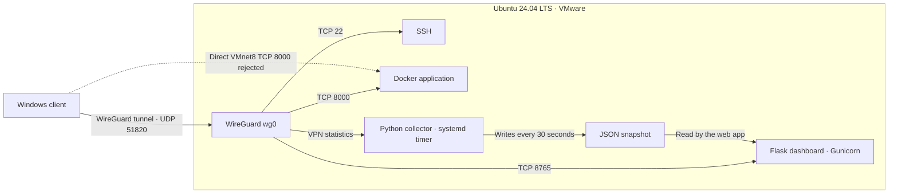

# WireGuard VPN Monitoring & Secure Docker Access

A local DevOps lab that connects a Windows client to an Ubuntu VM through WireGuard, restricts direct access to a Docker application on the tested VMware LAN path, and displays VPN metrics in a browser dashboard.

**Key result:** From the same Windows client, the Docker application returned `HTTP 200 OK` through the WireGuard tunnel. A direct TCP connection to the same published port through VMware VMnet8 was rejected. SSH also worked through the tunnel.

## VPN monitoring dashboard


The dashboard shows the tunnel interface status, registered peer count, latest handshake age, and cumulative bytes received and sent. It reads a JSON snapshot generated on the Ubuntu VM and marks the data as **stale** if the snapshot is older than 90 seconds.

A recent handshake means the peer exchanged WireGuard keys within the last three minutes. It does not prove the peer stayed online continuously. The RX and TX figures are byte totals, not instantaneous throughput.

## Architecture



| Component | Configuration and role |
| --- | --- |
| Windows client | Uses `10.66.77.2/32` and routes traffic for the server's VPN address through WireGuard. |
| Ubuntu WireGuard server | Uses `10.66.77.1/24` on `wg0`. Windows connects to the VMware endpoint at `192.168.132.165:51820/UDP`. |
| Docker application | Runs as `devops-app` and publishes TCP port `8000`. |
| Firewall | An iptables rule in `DOCKER-USER` matches traffic arriving on `ens33` and forwarded toward `docker0`. It matches the original destination port instead of relying on the container's IP address. |
| Dashboard | Flask runs behind Gunicorn on `10.66.77.1:8765`. Gunicorn runs as a non-root user under systemd. |
| Metrics collector | A systemd timer runs the Python collector every 30 seconds. The browser polls `/api/status` every 10 seconds. The snapshot does not expose WireGuard keys or peer endpoints. |

## Verification results

| Test | Observed result |
| --- | --- |
| WireGuard handshake and ping | The tunnel exchanged traffic. One Windows ping test received all four replies from the Ubuntu VPN address. |
| SSH through WireGuard | Windows established an SSH session with the Ubuntu VM at `10.66.77.1`. |
| Docker port through the VPN | `10.66.77.1:8000` returned `TcpTestSucceeded : True` using the WireGuard interface. |
| Docker port through VMware LAN | `192.168.132.165:8000` returned `TcpTestSucceeded : False` using VMnet8. |
| Docker application response | `http://10.66.77.1:8000/` returned `HTTP 200 OK` and the application's JSON response. |
| Monitoring dashboard | `/api/health` returned `HTTP 200 OK`. The browser displayed metrics from fresh WireGuard snapshots. |

### Docker access through VPN vs. VMware LAN

Both checks used the same Windows client and destination port. The destination address and interface identify which network path was tested.


### SSH through WireGuard

The SSH session targets the Ubuntu VPN address. After login, the terminal shows the `wg0` interface and its assigned address.


## Recheck from Windows

Run these commands in PowerShell with the Ubuntu VM running and the WireGuard client active. The IP addresses are specific to this lab.

```powershell
# Expected: TCP succeeds through the VPN.
Test-NetConnection 10.66.77.1 -Port 8000

# Expected: TCP fails through the direct VMware LAN path.
Test-NetConnection 192.168.132.165 -Port 8000

# Expected: HTTP 200 and the Docker application's JSON response.
curl.exe -i --max-time 5 http://10.66.77.1:8000/

# Expected: HTTP 200 from the dashboard health endpoint.
curl.exe -i --max-time 5 http://10.66.77.1:8765/api/health
```

## Scope and limitations

- The direct-access test covers the **IPv4 VMware LAN path** shown above. It does not establish that every non-VPN path is blocked.
- The project ran in a **local VMware lab**, not over the public internet.
- The dashboard service is enabled at startup, but automatic recovery after a full reboot was not verified.
- This repository documents the implementation and test evidence. It does not contain live VPN configuration or private keys.

Built and tested by **Defris Doloksaribu**.
